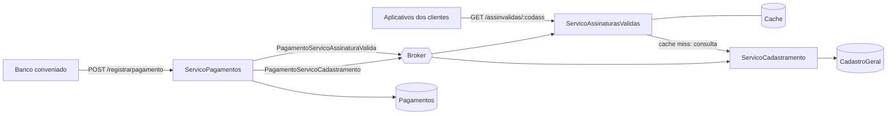

# Especificação — Sistema de Controle de Assinaturas de Aplicativos

> Fonte: documento da disciplina *Desenvolvimento de Sistemas Backend* (PDF original em `docs/specs/original/`).
> Este arquivo é a **fonte da verdade** do projeto. Marcações:
> - **[SPEC]** = exigido pelo professor. Não alterar contrato (rota, campos, formato).
> - **[DECISÃO]** = interpretação nossa onde a spec é omissa ou ambígua. Cada uma vira um ADR em `docs/adr/`.
> - **[EXTRA]** = além do pedido (frontend, login, documentação). Não pode quebrar nada do [SPEC].

---

## 1. Contexto

Startup que vende aplicativos por **assinatura mensal**. O app é baixado grátis, mas só funciona com assinatura válida.
Ao assinar, é gerado um **código de assinatura**; o app consulta periodicamente se o par cliente/assinatura continua válido e bloqueia se não estiver.

**Simplificação [SPEC]:** cada instância do sistema atende **uma única empresa**, com **um único usuário**.

## 2. Linguagem ubíqua (glossário)

| Termo | Significado |
|---|---|
| Aplicativo | Produto vendido por assinatura, com custo mensal |
| Cliente | Pessoa que assina aplicativos |
| Assinatura | Vínculo cliente ↔ aplicativo, com período de vigência |
| Vigência | Intervalo `inicioVigencia` → `fimVigencia` |
| ATIVA | `fimVigencia` **posterior** à data atual [SPEC] |
| CANCELADA | `fimVigencia` igual ou anterior à data atual (vencida). Não existe cancelamento manual |
| Pagamento | Registro de pagamento de uma assinatura, enviado pelo banco conveniado |
| Usuário | O único operador do sistema |

> **[DECISÃO]** Os nomes do domínio ficam **em português no código** (`Assinatura`, `Aplicativo`, `fimVigencia`), para o código falar a mesma língua da spec (princípio de *linguagem ubíqua* do DDD). Termos técnicos ficam em inglês (`Repository`, `UseCase`, `Controller`).

## 3. Entidades de domínio [SPEC]

| Entidade | Atributos |
|---|---|
| **Aplicativo** | `codigo` (inteiro longo), `nome` (texto), `custoMensal` (decimal) |
| **Cliente** | `codigo` (inteiro longo), `nome` (texto), `email` (texto) |
| **Assinatura** | `codigo`, `codApp`, `codCli` (inteiros longos), `inicioVigencia`, `fimVigencia` (data) |
| **Pagamento** | `codigo`, `codAssinatura` (inteiros longos), `valorPago` (decimal), `dataPagamento` (data) |
| **Usuario** | `usuario` (texto), `senha` (texto) |

> **[DECISÃO]** A spec diz "ponto flutuante" para valores. Internamente usamos **decimal exato** (`NUMERIC(12,2)` / `Prisma.Decimal`), porque float erra centavos (0.1 + 0.2 ≠ 0.3). No JSON o valor continua saindo como **número**, então o contrato não muda.
> **[DECISÃO]** A senha é guardada como **hash** (bcrypt/argon2), nunca em texto puro.

## 4. Arquitetura [SPEC]



| Serviço | Responsabilidade | Banco próprio |
|---|---|---|
| **ServicoCadastramento** | Cadastros (clientes, apps, assinaturas), preço, regras de validade | CadastroGeral |
| **ServicoPagamentos** | Registra pagamentos e publica eventos assíncronos | Pagamentos |
| **ServicoAssinaturasValidas** | Responde **rápido** se uma assinatura é válida, com cache. Deve suportar **várias instâncias** | Cache |

## 5. Regras de negócio

| ID | Regra | Origem |
|---|---|---|
| RN-01 | Ao criar uma assinatura: `inicioVigencia = hoje` e `fimVigencia = hoje + 7 dias` (7 dias grátis) | [SPEC] |
| RN-02 | Assinatura é **ATIVA** se `fimVigencia > hoje`; senão é **CANCELADA** (status é **calculado**, não armazenado) | [SPEC] |
| RN-03 | Um pagamento estende a validade da assinatura | [SPEC] |
| RN-04 | A **política de extensão muda com frequência** (prazo maior, períodos adicionais etc.), então deve ser trocável **sem mexer no resto do código** | [SPEC] |
| RN-05 | Política inicial de extensão: pagamento **com assinatura ativa** → `fimVigencia += 30 dias`. Pagamento **com assinatura vencida** → `fimVigencia = dataPagamento + 30 dias` (reativa) | [DECISÃO] ⚠️ confirmar |
| RN-06 | Pagamento com `valorPago` **menor** que o `custoMensal` é registrado, mas **não estende** a validade | [DECISÃO] ⚠️ confirmar |
| RN-07 | Assinatura só pode ser criada para cliente e aplicativo existentes (senão, 404) | [DECISÃO] |
| RN-08 | Datas são **dias de calendário** (sem hora), no fuso `America/Sao_Paulo` | [DECISÃO] |

> RN-04 é o ponto em que a **Clean Architecture brilha**: a política vira uma interface do domínio (`PoliticaRenovacao`), com implementações trocáveis (padrão *Strategy*). Mudar a regra = trocar uma classe.

## 6. Contratos de API [SPEC]

### 6.1 ServicoCadastramento (prefixo `/servcad`)

| Método e rota | Entrada | Resposta |
|---|---|---|
| `GET /servcad/clientes` | — | `[{codigo, nome, email}]` |
| `GET /servcad/aplicativos` | — | `[{codigo, nome, custo}]` ⚠️ |
| `POST /servcad/assinaturas` | `{codCli, codApp}` | `{codigo, codCli, codApp, inicioVigencia, fimVigencia}` |
| `PATCH /servcad/aplicativos/:idAplicativo` | `{custo}` | `{codigo, nome, custoMensal}` ⚠️ |
| `GET /servcad/assinaturas/:tipo` | `tipo = TODAS \| ATIVAS \| CANCELADAS` | `[{codigo, codCli, codApp, inicioVigencia, fimVigencia, status}]` |
| `GET /servcad/asscli/:codcli` | código do cliente | mesma lista acima, filtrada por cliente |
| `GET /servcad/assapp/:codapp` | código do aplicativo | mesma lista acima, filtrada por aplicativo |
| `GET /servcad/assinvalidas/:codass` | código da assinatura | `true` / `false` — [DECISÃO] ver P-03 |

**Exemplo — `POST /servcad/assinaturas`**
```json
// requisição
{ "codCli": 3, "codApp": 1 }
// resposta 201
{ "codigo": 12, "codCli": 3, "codApp": 1, "inicioVigencia": "2026-11-04", "fimVigencia": "2026-11-11" }
```

**Evento consumido:** `PagamentoServicoCadastramento` → aplica a política de renovação (RN-05/RN-06).

### 6.2 ServicoPagamentos

| Método e rota | Entrada | Resposta |
|---|---|---|
| `POST /registrarpagamento` | `{dia, mes, ano, codass, valorPago}` | sem corpo (`201` ou `204`) |

Fluxo: valida a entrada → grava o pagamento no **seu** banco → publica **dois eventos** com o mesmo corpo:
- `PagamentoServicoCadastramento`
- `PagamentoServicoAssinaturaValida`

### 6.3 ServicoAssinaturasValidas

| Método e rota | Entrada | Resposta |
|---|---|---|
| `GET /assinvalidas/:codass` | código da assinatura | `true` / `false` |

Fluxo: consulta o cache → se não achar (*cache miss*), pergunta ao ServicoCadastramento → guarda no cache → responde.
**Evento consumido:** `PagamentoServicoAssinaturaValida` → **remove** a entrada daquela assinatura do cache.

### 6.4 Corpo dos eventos [SPEC]
```json
{ "dia": 4, "mes": 11, "ano": 2026, "codass": 12, "valorPago": 29.90 }
```

## 7. Requisitos não funcionais

| ID | Requisito | Origem |
|---|---|---|
| RNF-01 | Cada serviço tem **seu próprio banco**; nenhum serviço acessa o banco do outro | [SPEC] |
| RNF-02 | Comunicação de pagamentos **assíncrona**, via broker | [SPEC] |
| RNF-03 | ServicoAssinaturasValidas responde rápido e roda em **várias instâncias** | [SPEC] |
| RNF-04 | **Script de inicialização (seed):** ≥ 10 clientes, ≥ 5 aplicativos, ≥ 5 assinaturas | [SPEC] |
| RNF-05 | Tudo sobe localmente com um `docker compose up` | [DECISÃO] |
| RNF-06 | Documentação: Swagger/OpenAPI por serviço, AsyncAPI para os eventos, diagramas C4, ADRs | [EXTRA] |

## 8. Frontend [EXTRA]

Painel administrativo em Next.js para o usuário único:
- **Login**
- **Clientes:** listagem
- **Aplicativos:** listagem e edição do custo mensal
- **Assinaturas:** listagem com filtro TODAS/ATIVAS/CANCELADAS, criação, visão por cliente e por aplicativo
- **Simulador do banco:** formulário que chama `POST /registrarpagamento`, para demonstrar o fluxo de eventos
- **Verificador:** consulta `GET /assinvalidas/:codass`, como um app faria

## 9. Pontos em aberto (lacunas da spec)

| ID | Problema encontrado | Recomendação |
|---|---|---|
| P-01 | A spec não define **quanto** o pagamento estende, nem o que acontece com pagamento atrasado ou valor menor | Adotar RN-05 e RN-06 e **confirmar com o professor** |
| P-02 | Campo do custo inconsistente: `custo` (GET e PATCH) × `custoMensal` (entidade e resposta do PATCH) | Seguir o texto **literalmente** em cada endpoint até o professor confirmar |
| P-03 | O AssinaturasValidas precisa consultar o Cadastramento, mas **nenhum endpoint** foi especificado para isso | Criar `GET /servcad/assinvalidas/:codass` (interno) |
| P-04 | **Bug de cache:** se o cache guardar `true`, a assinatura vence sem pagamento e o cache continua dizendo `true` para sempre (só pagamento limpa o cache) | O cache guarda a **`fimVigencia`**, não o booleano, e calcula a validade na hora da consulta. Mais um TTL curto como segurança |
| P-05 | **Condição de corrida:** os dois eventos chegam juntos; o AssinaturasValidas limpa o cache, pergunta ao Cadastramento **antes** de ele atualizar a data e guarda o valor **antigo** | TTL curto no cache (ex.: 60 s) e registro do problema em ADR (consistência eventual) |
| P-06 | **Várias instâncias** com cache em memória: cada instância tem o próprio cache, e todas precisam receber o evento de invalidação | Cache **compartilhado no Redis** (uma fila só basta) |
| P-07 | A entidade Usuario existe, mas **não há endpoint de login**; e os apps e o banco não teriam como fazer login | Endpoints da spec **ficam abertos**, como especificado. O login protege só o **frontend** |
| P-08 | Assinatura inexistente em `GET /assinvalidas/:codass` | Responder `false` (não 404): para o app, "não existe" = "não pode usar" |
| P-09 | A descrição de `GET /servcad/assinaturas/{tipo}` diz "vigentes", mas aceita TODAS e CANCELADAS | Seguir o parâmetro `tipo` |

## 10. Critérios de aceite (resumo)

- [ ] `docker compose up` sobe os 3 serviços, Postgres (2 bancos), broker, cache e frontend
- [ ] Seed cria 10 clientes, 5 aplicativos e 5 assinaturas
- [ ] Assinatura nova tem exatamente 7 dias de vigência
- [ ] `POST /registrarpagamento` grava o pagamento e os **dois** eventos são consumidos
- [ ] Depois de um pagamento, `GET /assinvalidas/:codass` reflete a nova validade
- [ ] Uma assinatura que vence sem pagamento passa a responder `false` (P-04 resolvido)
- [ ] Trocar a política de renovação exige mudar só **uma** classe de infraestrutura e configuração
- [ ] Todos os endpoints aparecem no Swagger com exemplos
